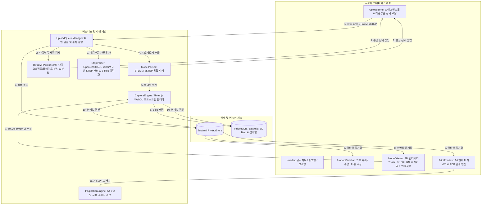

# 3D(STL/3MF/STEP) 기반 상품 안내서 및 사진 생성기 시스템 아키텍처 & 기술 설계서
(System Architecture & Technical Specification Document)

**버전**: v1.4.0  
**최종 갱신일**: 2026-08-19  
**지원 포맷**: STL (`.stl`), 3MF (`.3mf`), STEP / STP (`.step`, `.stp`)  
**프로젝트 목적**: 3D 모델(STL, 3MF, STEP) 파일을 브라우저 로컬에서 안전하고 빠르게 파싱하여 최적의 3D 상품 사진(썸네일)을 생성하고, A4 6분할 표준 규격 출고 상품 안내서를 원클릭으로 출력하는 올인원 웹 애플리케이션.

---

## 1. 시스템 핵심 설계 원칙 (Core Architectural Principles)

1. **Zero-Server / 100% Client-Side Privacy**:
   - 업로드된 3D 파일(STL, 3MF, STEP) 및 생성된 렌더링 이미지는 외부 서버로 일절 전송되지 않으며, 사용자의 브라우저 메모리 및 IndexedDB(Dexie.js) 내에서만 처리됩니다.
2. **Multi-Format CAD / 3D Engine**:
   - STL(Mesh), 3MF(Multi-Plate/Object ZIP), STEP/STP(OpenCASCADE WebAssembly B-Rep Tessellation)을 모두 지원하는 통합 3D 파이프라인.
3. **Deterministic Print Form (A4 6-Slot Grid Standard)**:
   - 상품 개수(1개~6개 이상)에 구애받지 않고, 항상 2열 × 3행(6슬롯) 규격 카드 사이즈(폭, 높이, 이미지 비율, 폰트 크기)를 엄격히 고정 유지합니다.
4. **Single Source of Truth & Atomic State Synchronization**:
   - Zustand 기반 단일 상태 스토어(`projectStore.ts`)를 중심으로 3D 뷰어 화면, 사이드바 카드, 우측 A4 인쇄 미리보기가 100% 실시간 양방향 동기화됩니다.

---

## 2. 전체 시스템 아키텍처 및 데이터 흐름도



---

## 3. 데이터 도메인 모델 (Domain Models)

### 3.1. 상품 아이템 모델 (`ProductItem`)
```typescript
export interface ProductItem {
  id: string;                      // 고유 UUID
  order: number;                   // 사이드바 및 인쇄 순서 (0-indexed)
  source: {                        // 원본 파일 메타데이터
    name: string;
    size: number;
    lastModified: number;
    type: string;                  // 'model/stl' | 'model/3mf' | 'model/step'
    duplicateKey: string;
  };
  displayName: string;             // 상품명 (최대 80자, 확장자 제거 및 포맷팅)
  quantity: number;                // 출고 수량 (1 ~ 999)
  status: 'queued' | 'parsing' | 'rendering' | 'ready' | 'error';
  blobId: string;                  // IndexedDB에 저장된 원본 3D 파일 Blob ID
  thumbnailBlobId?: string;        // IndexedDB에 저장된 캡처 썸네일 Blob ID
  camera: CameraState;             // 카메라 앵글 (위치, 타겟, 줌, 프리셋)
  shadingMode?: 'technical' | 'clay' | 'metallic'; // CAD / 클레이 / 메탈 셰이딩
  colorHex?: number;               // 10대 대표 원색 HEX (기본: 0xdde3eb)
  showEdges?: boolean;             // 외곽선 엣지 라인 표시 여부 (기본: true)
  bounds?: { width: number; depth: number; height: number }; // 3D 실측 치수 (mm)
  triangleCount?: number;          // 삼각 폴리곤 개수
  partIndex?: number;              // 3MF/STEP 내 개별 오브젝트 인덱스
  plateIndex?: number;             // 슬라이서 다중 플레이트 인덱스
  splitChoice?: 'split-objects' | 'split-plates' | 'merge-all';
  createdAt: string;
  updatedAt: string;
}
```

---

## 4. 모듈별 상세 아키텍처 및 역할

### 4.1. 3D 지오메트리 파싱 엔진 (`src/lib/stl/`, `src/lib/threemf/`, `src/lib/step/`, `src/lib/model/`)
- **`stlParser.ts`**: Binary/ASCII STL 파싱, Z-Up $\rightarrow$ Y-Up 변환.
- **`threemfParser.ts`**: 3MF 압축 해제, 2단계 하이브리드 파서, 다중 부품/플레이트 분할.
- **`stepParser.ts` [NEW]**:
  - `occt-import-js` (OpenCASCADE WebAssembly) 기반으로 브라우저 로컬에서 STEP/STP 파일의 B-Rep 솔리드 형상을 고정밀 3D 삼각 메쉬(Three.js `BufferGeometry`)로 변환.
  - STEP 내 다중 바디(Multi-body Assembly) 자동 감지 및 개별 부품 분리(`split-objects`) 또는 단일 어셈블리 합성(`merge-all`) 지원.
- **`modelParser.ts`**: 확장자별 통합 디스패처 (`parseModelFile`, `inspectModelFile`).

### 4.2. 3D 렌더링 & 오프스크린 캡처 엔진 (`src/lib/three/`)
- 1024x1024 오프스크린 WebGL 렌더러 (`captureEngine.ts`).
- 3종 셰이딩(CAD/클레이/메탈) + 15도 엣지 검출 + 10대 원색 팔레트 실시간 동기화.

### 4.4. 사이드바 리스트 순서 정렬 엔진 (`src/features/products/`)
- `@dnd-kit` 기반 수직 정렬 (`verticalListSortingStrategy`).
- `restrictToVerticalAxis` 모디파이어 및 카드별 `transform.x = 0` 하드웨어 가속 이중 잠금으로 마우스/터치 드래그 시 좌우 흔들림 없이 오직 상/하(Y축)로만 매끄럽게 슬라이드.

### 4.6. macOS 독립형 데스크톱 앱 엔진 (`electron/`, `electron-builder`)
- Electron 런타임을 통해 웹 브라우저나 로컬 서버 구동 없이 네이티브 데스크톱 앱으로 완벽 구동.
- WebGL 3D 하드웨어 가속, WASM 모듈(`occt-import-js.wasm`), 로컬 IndexedDB 스토리지 연동.
- macOS 전용 단축키(Cmd+P 인쇄, Cmd+Q 종료 등) 및 창 관리.
- **빌드 명령어**:
  - `npm run app:dist`: 즉시 실행 가능한 macOS `.app` 번들 생성 (`release/mac-arm64/KIMCRE-3D-Guide.app`)
  - `npm run app:dmg`: 설치용 디스크 이미지 `.dmg` 생성 (`release/KIMCRE-3D-Guide-1.0.0-arm64.dmg`)
  - `npm run app:start`: 빌드된 Mac 앱 즉시 실행

---

## 5. 저장소 구조 (Directory Structure)

```text
STL기반 상품사진+이름 생성기/
├── docs/
│   └── architecture_and_specification.md   # [본 문서] 시스템 아키텍처 및 기술 설계서
├── electron/                               # Electron 메인 & 프리로드 프로세스
│   ├── main.cjs
│   └── preload.cjs
├── public/
│   └── occt-import-js.wasm                 # OpenCASCADE WebAssembly 바이너리 (7.6MB)
├── release/                                # [빌드 결과물] Mac .app 번들 및 .dmg 파일
│   ├── KIMCRE-3D-Guide-1.0.0-arm64.dmg
│   └── mac-arm64/
│       └── KIMCRE-3D-Guide.app
├── src/
│   ├── components/                         # 공통 UI 컴포넌트 (Header, Modal 등)
│   ├── features/
│   │   ├── upload/                         # 파일 업로드 & 선택 모달 (UploadZone, uploadQueue)
│   │   ├── products/                       # 사이드바 상품 카드 목록 & 수직 드래그 락 (ProductList, ProductItemCard)
│   │   ├── viewer/                         # 3D WebGL 뷰어 & 툴바 (ModelViewer)
│   │   └── print-preview/                  # A4 6분할 인쇄 미리보기 & 인쇄 엔진 (PrintPreview, PrintDocument)
│   ├── lib/
│   │   ├── model/                          # 통합 3D 모델 파서 (modelParser)
│   │   ├── stl/                            # STL 바이너리/아스키 파서 (stlParser)
│   │   ├── threemf/                        # 3MF 파싱 & 부품 분할 엔진 (threemfParser)
│   │   ├── step/                           # STEP/STP OpenCASCADE WASM 파서 (stepParser)
│   │   ├── three/                          # Three.js 씬, 조명, 캡처 엔진 (captureEngine, cameraFit)
│   │   ├── print/                          # A4 6분할 그리드 & 반응형 폰트 계산 (pagination)
│   │   ├── persistence/                    # IndexedDB 스토리지 (db.ts, Dexie)
│   │   └── validation/                     # 입력 검증 및 파일명 정제 (validators)
│   ├── store/                              # 전역 상태 관리 (projectStore.ts, Zustand)
│   └── types/                              # TypeScript 전역 인터페이스 정의 (index.ts, declarations.d.ts)
└── e2e/                                    # Playwright E2E 자동화 테스트 스위트
```


